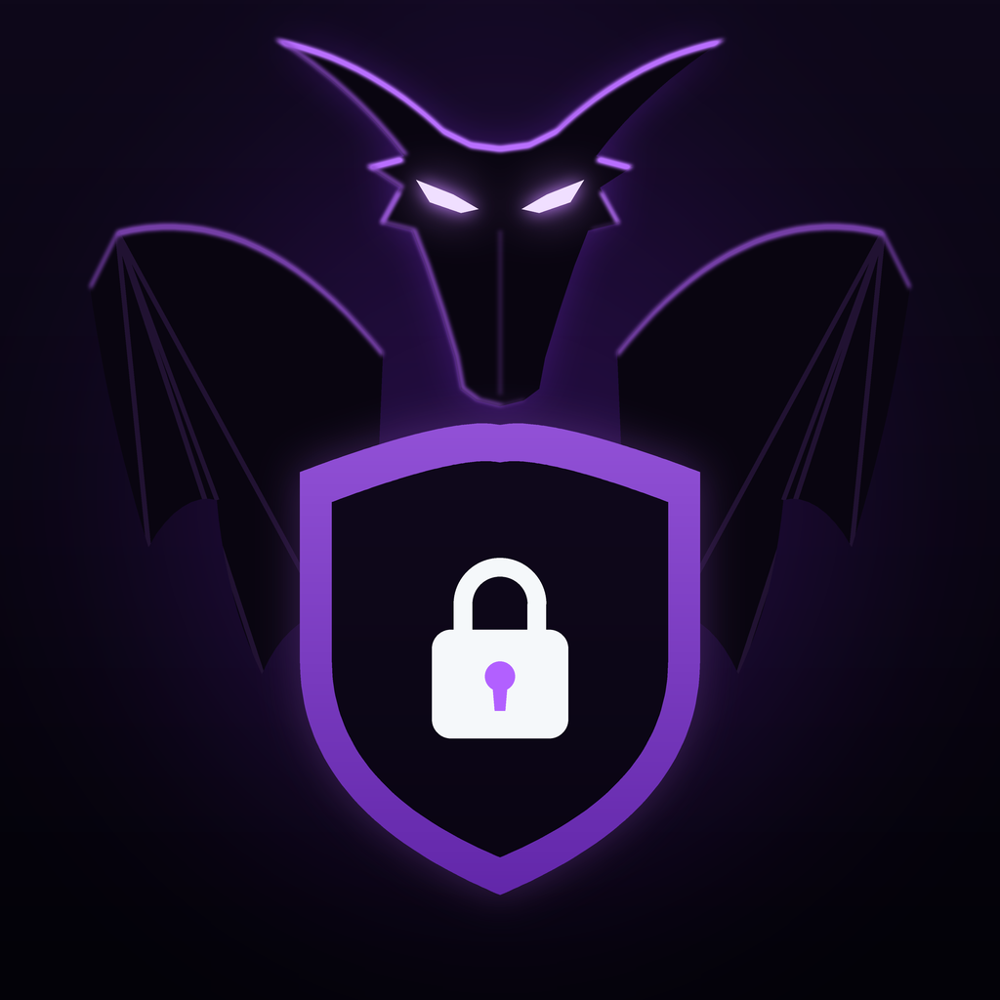
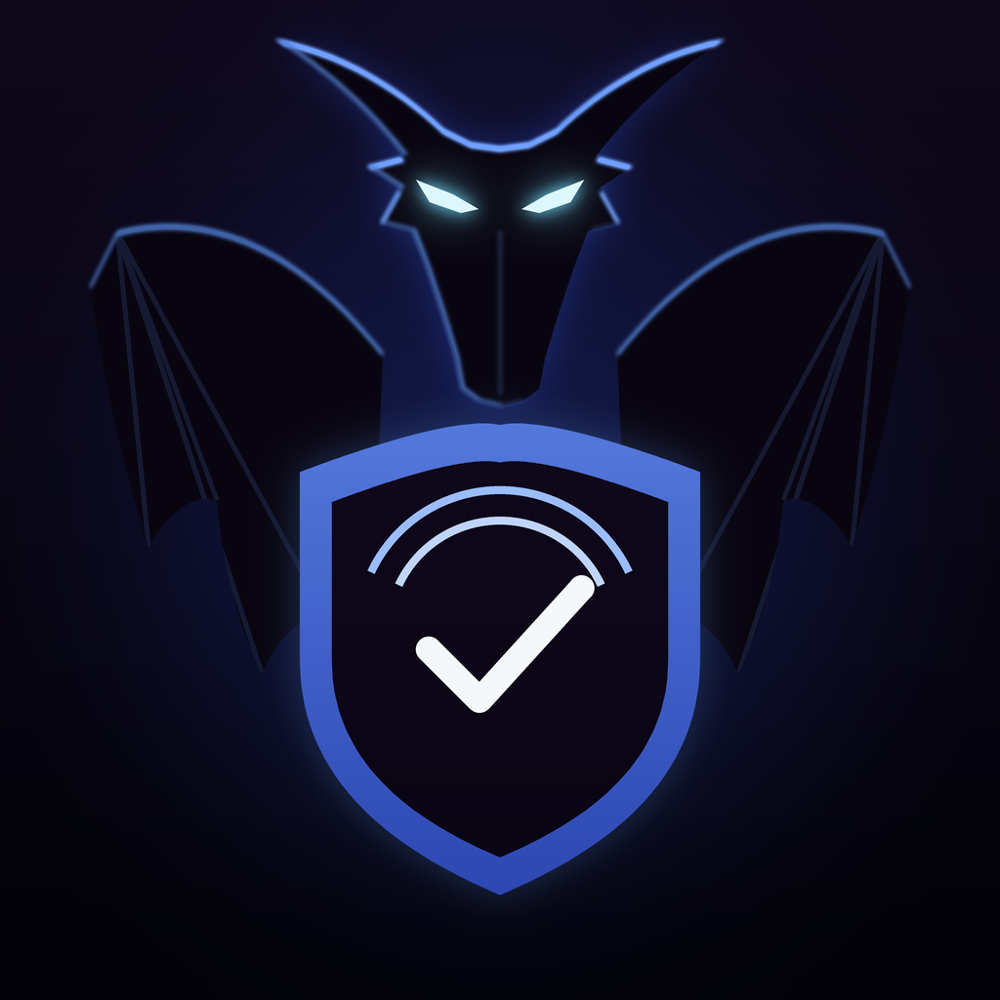
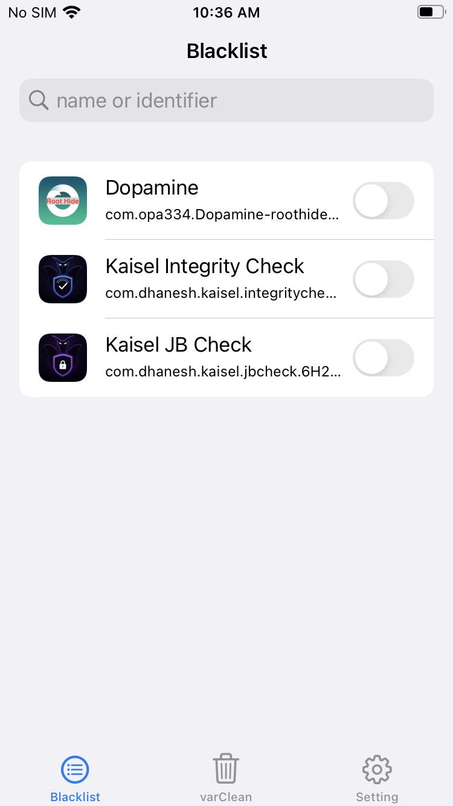
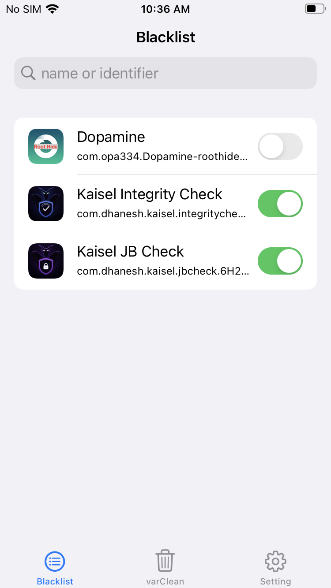
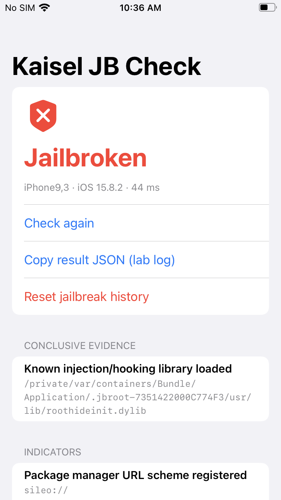
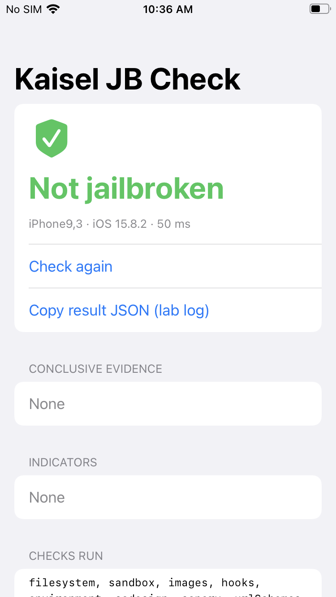
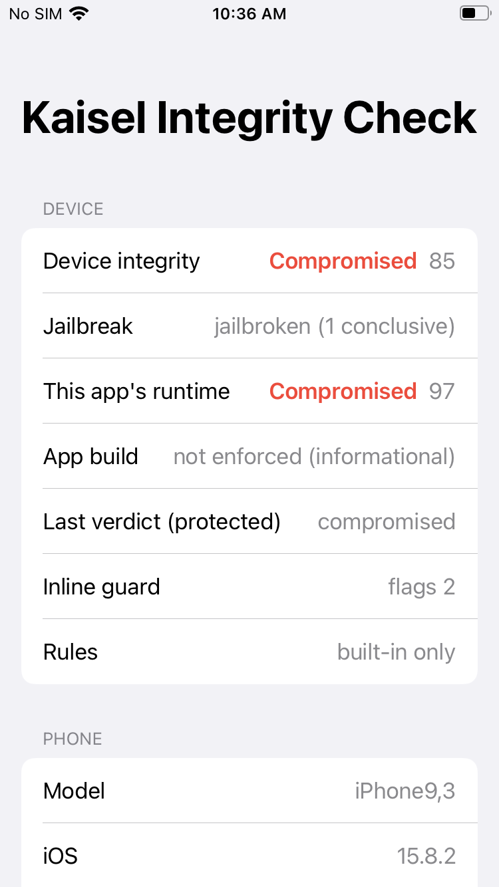
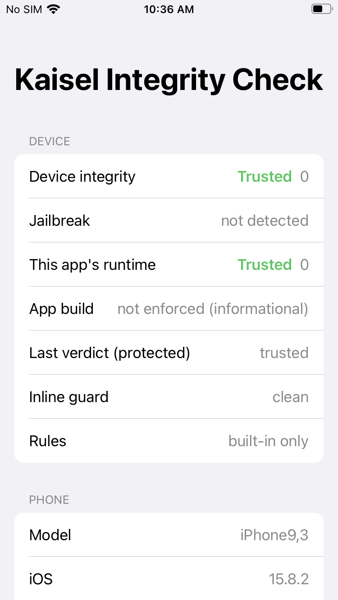
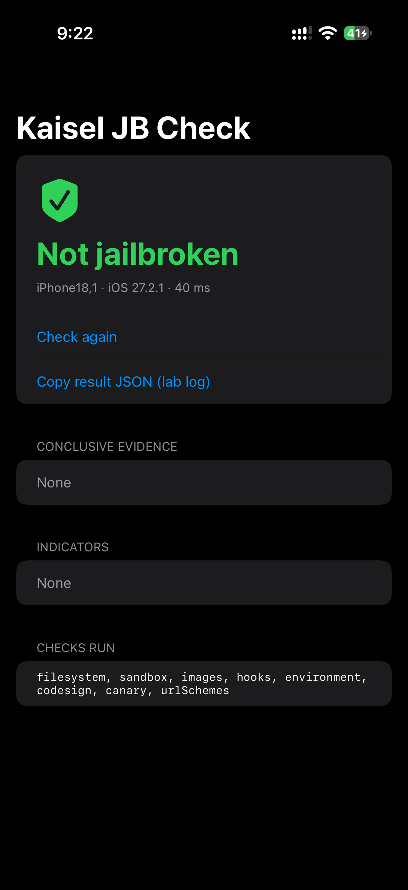
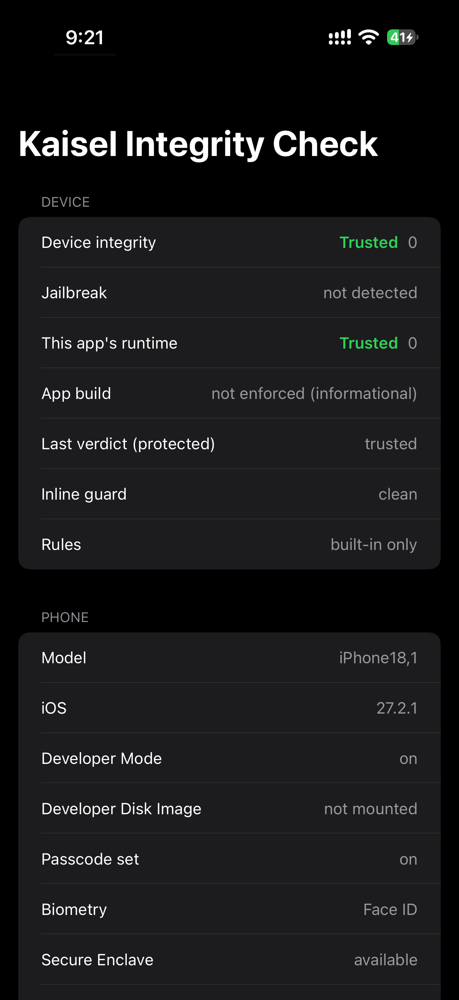

<p align="center">
  
  &nbsp;&nbsp;
  
</p>

<h1 align="center">Kaisel</h1>

<p align="center">
  Layered jailbreak, instrumentation and device-integrity detection for iOS 15 to 27.<br>
  A Swift package, two ready-to-install apps and a reference attestation server.
</p>

<p align="center">
  <a href="https://github.com/0xdhanesh/Kaisel/actions/workflows/ci.yml"></a>
  <a href="https://github.com/0xdhanesh/Kaisel/releases"></a>
  
  
  
  
  <a href="LICENSE"></a>
</p>

---

## Apps

| | App | What it answers |
|---|---|---|
|  | **Kaisel JB Check** | *Is this phone jailbroken?* **Jailbroken**, **Suspicious** or **Not jailbroken**, with the evidence. Nothing about how the app itself was built or signed. |
|  | **Kaisel Integrity Check** | Separate **device**, **runtime** and **app-build** verdicts with risk scores, phone posture (Developer Mode, passcode, biometry, Secure Enclave, App Attest), and a report sealed for server-side verification. |

Both apps install with a **free Apple ID** through Xcode, [Impactor](https://github.com/khcrysalis/impactor) or Sideloadly. Both show a **Reset jailbreak history** button while a "seen jailbroken" marker exists on the device.

## What Kaisel is, and is not

Kaisel is a reference implementation of the techniques commercial RASP products use for jailbreak and instrumentation detection. It cross-checks independent views of the same fact rather than grepping for paths, scores evidence per domain, and hands the final decision to a server.

It is **not** a certified product, it has no commercial-grade code obfuscation, and its indicator set is maintained by hand. It is suited to lab work, security assessments and as a baseline to compare RASP products against. It should not be the only control protecting a production app.

## Features

- **Jailbreak detection that is not a path grep.** Raw `svc #0x80` syscalls compared with libc to catch hiding tweaks, an `errno` existence oracle, sealed-system-volume and mount checks, sandbox-escape probes, and rootless (`/var/jb`) and rootful artefacts.
- **Injection and hooking.** Two independent loaded-image lists (dyld info vs `_dyld` API), explicit image classes (known jailbreak injector, instrumentation, broad marker, unknown external; since 1.4.0 only exact injector identities or jailbreak-root paths are conclusive), inline trampoline decoding, GOT / fishhook rebinding, `__interpose`, Objective-C swizzling and syscall-stub integrity.
- **Frida and debuggers.** Frida threads, D-Bus handshake probe, anonymous executable memory, `P_TRACED`, `CS_DEBUGGED`, exception ports and the parent process.
- **App integrity.** Entitlement blob (TrollStore and ldid fingerprints), FairPlay `cryptid`, provisioning profile, team and bundle ID, `__TEXT` hash.
- **Residual signals for hidden jailbreaks** (indicators, never conclusive on their own): dyld integrity where dyld runs from disk, userspace-reboot state, and a Keychain marker of an earlier conclusive result. None of them fired against RootHide's Blacklist in the latest lab runs (see below).
- **One jailbreak rule everywhere.** `JailbreakEvidence` decides what is conclusive for JB Check, the full kit, stored history and the server. Since 1.4.0 the rule and the image lists live in one manifest, `Server/classification.json`, and parity tests fail if the Swift, C and Python copies drift.
- **Self-protection.** Runtime self-integrity snapshots, scattered inline guards, check-completion bookkeeping, randomised check order, a tamper-evident verdict and XOR-obfuscated indicator strings.
- **Weighted scoring per domain.** Every signal is evidence with a weight; a damped noisy-OR produces device, runtime and app verdicts. Build and posture facts are informational unless you opt in.
- **Hardware-backed sealing.** App Attest assertions and a Secure Enclave P-256 signature bind a report to a server nonce.
- **Signed remote rules.** Add indicators and tune weights without an app release (ECDSA P-256, anti-rollback, expiry, additive only).
- **Reference server** in Python that verifies App Attest and the seal, validates the report against its own SDK profile (strict mode by default since 1.4.0: an incomplete, malformed, unsupported or unauthenticated report is never `allow`), re-scores with its own policy, remembers App Attest keys that were once seen jailbroken, and answers `allow`, `step_up` or `deny`.

## Lab results so far

Real-device results recorded for 1.3.x on 2026-11-21. Screenshots are below; details and earlier runs are in [docs/LAB.md](docs/LAB.md).

| Device / iOS | Scenario | Result |
|---|---|---|
| iPhone9,3 (iPhone 7) / iOS 15.8.2 | Dopamine + RootHide, app **not hidden** | **Detected**. JB Check: Jailbroken (conclusive: RootHide injector `roothideinit.dylib` loaded from the `.jbroot-*` path; indicator: `sileo://` URL scheme). Integrity Check: device Compromised 85, runtime Compromised 97, inline guard flags 2 |
| iPhone9,3 / iOS 15.8.2 | Dopamine + RootHide, app **hidden** (Blacklist) | **Missed**. JB Check: Not jailbroken, no evidence, no indicators. Integrity Check: device Trusted 0, runtime Trusted 0, inline guard clean. An earlier 1.3.1 run read Suspicious; that did not reproduce in these runs |
| Lab device (model and iOS not yet recorded) | TrollStore installed with TrollInstallerX | **Detected** by both apps |
| Stock device / iOS 26 | Not jailbroken | **Clean**, no false positive |
| Stock iPhone18,1 / iOS 27.2.1 | Not jailbroken | **Clean** in 1.3.1 (1.3.0 had a dyld false positive, fixed). JB Check: Not jailbroken; Integrity Check: Trusted 0 |

Not yet tested: palera1n (rootful and rootless), Dopamine on A12+, frida-server and FridaGadget, Shadow-class hiding tweaks, iOS 16 to 25. Result JSON for the runs above has not yet been exported into `Lab/results/`, so the hidden-case miss is recorded from screenshots only. The 1.4.0 changes (unreleased) have not been run on any device yet. The full matrix of implemented, unit-tested and device-validated detection is in [Lab/COVERAGE.md](Lab/COVERAGE.md).

"Not jailbroken" means no conclusive or indirect evidence was observed by the app. It is not proof that the device is stock.

### Evidence: Dopamine + RootHide, iPhone9,3, iOS 15.8.2

The same two apps were run with RootHide's Blacklist toggles off (not hidden) and on (hidden). Dopamine itself stayed off the Blacklist.

| Blacklist off (not hidden) | Blacklist on (hidden) |
|---|---|
|  |  |

| | Not hidden: **detected** | Hidden: **missed** |
|---|---|---|
| **JB Check** |  |  |
| **Integrity Check** |  |  |

Unhidden, RootHide still injects `roothideinit.dylib` into the app, and that single image is enough for a conclusive verdict. Hidden, nothing is injected, the jailbreak root sits at a random path, the package-manager URL schemes are filtered, and none of the 1.3 residual signals (`dyldModified`, `userspaceReboot`, `previouslyJailbroken`) fired. JB Check also showed no **Reset jailbreak history** button in the hidden run, so the Keychain marker was not seen there.

### Evidence: stock iPhone18,1, iOS 27.2.1 (not jailbroken)

| JB Check | Integrity Check |
|---|---|
|  |  |

No false positive: no evidence or indicators, and device and runtime both Trusted 0 with Developer Mode on.

## Quick start

```bash
brew install xcodegen
git clone https://github.com/0xdhanesh/Kaisel.git
cd Kaisel/Apps && xcodegen generate && open Kaisel.xcodeproj
```

Pick the `KaiselJBCheck` or `KaiselIntegrityCheck` scheme, choose your team under **Signing & Capabilities**, and run on a real device.

**No Mac?** Download an unsigned IPA from [Releases](https://github.com/0xdhanesh/Kaisel/releases) and install it with Impactor or Sideloadly: see [Sideloading](docs/SIDELOADING.md). Use 1.3.1 or later; the 1.3.0 release has a false positive on stock iOS 16 and later.

## Requirements

| | |
|---|---|
| Devices | iPhone or iPad on iOS 15.0 to 27 (the Simulator is detected and flagged) |
| Build | macOS 14+, Xcode 15+ (Swift 5.9), XcodeGen |
| Signing | Free Apple ID for both apps; paid team only for the App Attest variant |
| Server (optional) | Python 3.10+ |

## Installation options

| Method | Needs a Mac | Account | Guide |
|---|---|---|---|
| Xcode, run on device | Yes | Free or paid | [Building › Option A](docs/BUILDING.md#option-a-xcode-run-directly-on-your-phone) |
| Signed IPA (`Scripts/build_ipa.sh`) | Yes | Free or paid | [Building › Option B](docs/BUILDING.md#option-b-signed-ipa-from-the-command-line) |
| Unsigned IPA + Impactor / Sideloadly | No (with Releases) | Free | [Sideloading](docs/SIDELOADING.md) |

A free Apple ID signs apps for **7 days**; reinstall to renew. See [free account limits](docs/SIDELOADING.md#free-apple-id-limits).

## Using the package

```swift
// Package.swift
.package(url: "https://github.com/0xdhanesh/Kaisel.git", from: "1.3.1")
.product(name: "KaiselKit", package: "Kaisel")
```

```swift
import KaiselKit

// Jailbreak only
let result = await JailbreakDetector().check()
print(result.status)                 // .jailbroken / .suspicious / .notJailbroken

// Full assessment, sealed for your backend
let kit = IntegrityKit(configuration: .init(expectedDistribution: .appStore,
                                            expectedTeamIdentifier: "ABCDE12345"))
let report = await kit.evaluate()
let sealed = try await kit.seal(report, serverNonce: nonceFromServer)
// send `sealed` to your server; the server decides

// Clear the "seen jailbroken" Keychain marker (for example after a device is restored)
JailbreakHistory.reset()
```

Full guide: [Integration](docs/INTEGRATION.md).

## Documentation

| Topic | |
|---|---|
| [Building](docs/BUILDING.md) | Requirements, Xcode, CLI and unsigned builds, common errors |
| [Sideloading](docs/SIDELOADING.md) | Impactor, Sideloadly, Developer Mode, free-account limits |
| [Detection](docs/DETECTION.md) | How a jailbreak is decided, every technique, scoring, iOS 15 to 27 observability |
| [Architecture](docs/ARCHITECTURE.md) | Package layout and RASP features |
| [Integration](docs/INTEGRATION.md) | Using KaiselKit in your app, build hardening, remote rules, App Store notes |
| [Server](docs/SERVER.md) | App Attest, Play Integrity comparison, reference server, server-side verification |
| [Limitations](docs/LIMITATIONS.md) | Known bypasses and what is still unproven |
| [Lab](docs/LAB.md) | Validating on jailbroken devices; recorded runs and test status |
| [Coverage](Lab/COVERAGE.md) | What is implemented, unit-tested and validated on real devices, and what has never been tested |
| [1.4.0 validation](docs/V1.4.0-VALIDATION.md) | What changed in 1.4.0, the tests that ran, and the release gates still open |
| [Pentesting iOS RASP](docs/Pentesting%20iOS%20RASP.md) | Adversary-centred assessment methodology in five layers, tiered test plan, results and reporting templates, standards mapping, and how Kaisel maps to each layer |

## Honest limitations

Any check running on a device the attacker controls can be bypassed. Kaisel makes bypassing more expensive and more visible, and gives your server verifiable evidence. It is not proof.

- **Per-app hiding is currently a miss.** With the app in RootHide's Blacklist both apps read clean (Not jailbroken, Trusted 0; see the screenshots above): the app runs with nothing injected, the jailbreak root is at a random path and the URL schemes are filtered. An earlier run read *Suspicious*, but it did not reproduce. Treat "Not jailbroken" as *no evidence*, not as proof of a stock device, and keep the decision on the server: its per-key history targets the "run once, then hide" pattern but has not yet been lab-verified.
- **dyld integrity is an indicator, not proof.** From iOS 16 dyld runs from its copy in the shared cache, which differs from `/usr/lib/dyld` on any stock phone. Since 1.3.1 in-cache dyld is skipped, large differences are ignored, and `dyldModified` can never make a device "Jailbroken" on its own. In practice it only has a chance on iOS 15.
- **Kernel-level hiding** defeats filesystem and code-signing checks, because the kernel itself answers. In-process signals (images, hooks, threads, memory, entitlements) still apply.
- **Apple has no "this device is not jailbroken" attestation.** App Attest proves a genuine app on real hardware, not a stock OS.
- **The server cannot prove the checks ran.** Check-completion bits are reported by the app. The reference server requires every expected check before `allow`, but App Attest only proves which app instance signed the report, not that measurements inside a compromised process are true.
- **In-bundle code is classified by name only.** A renamed library injected into a re-signed app's bundle is not caught by image classification; App Attest, team ID and `__TEXT` hash checks are the backstops.
- **Coverage is limited to the runs listed above.** Every other expectation in [`Lab/expected.json`](Lab/expected.json) is a hypothesis until tested. Please contribute lab results.

Read [Limitations](docs/LIMITATIONS.md) before relying on Kaisel for any security decision. **Never gate anything security-critical on the client-side verdict alone.**

## Roadmap

Candidate improvements from the gap analysis in [Pentesting iOS RASP § 11](docs/Pentesting%20iOS%20RASP.md#11-proposed-kaisel-tweaks). None is implemented yet; each will be validated on stock iOS 15 to 27 before it is scored. Per-app hiding is the priority, because the RootHide Blacklist case is a miss today.

| Area | Item |
|---|---|
| Quick wins | Hardware breakpoint / watchpoint detection from debug registers · full code-signing flag profile · kernel task-port probe for older jailbreaks · Apple-Silicon-Mac and virtual-device signals · report to the server by default rather than blocking locally |
| Hidden and renamed jailbreaks (priority) | Re-test the 1.3 residual signals hidden, with result JSON exported, to see why none fired · mount-table enumeration · build manifest of load commands and bundled frameworks (catches a renamed Frida Gadget inside the app bundle) · DeviceCheck "seen jailbroken" bits in the reference server |
| Instrumentation | Mach-O header scan of anonymous executable memory · Kaisel self-`__TEXT` hash · new-thread inventory |
| Server | `AppTransaction` (StoreKit 2) verification · transaction-bound nonces · App Attest receipt risk metric · report consistency checks |
| Research (lab only first) | Sandbox-policy probes · boot-session timeline per key · sysctl surface fingerprint |

## Responsible use

Kaisel is for defensive security, research and testing that you are **authorised** to perform: protecting your own apps, assessing devices you own or manage, and engagements with written permission. Do not use it to evade other apps' protections or against devices or users without consent. See [SECURITY.md](SECURITY.md) to report vulnerabilities.

## Contributing

Contributions are welcome, especially lab results from jailbroken devices and new indicators. See [CONTRIBUTING.md](CONTRIBUTING.md).

Contact: [0xdhanesh](https://github.com/0xdhanesh) · dhanesh.professional@gmail.com

## Licence

[MIT](LICENSE) © 2026 0xdhanesh.

*Kaisel is an independent open-source project. The name is a nod to a character from the Solo Leveling series; the project is not affiliated with or endorsed by its creators or publishers, and the app icons are original artwork.*
